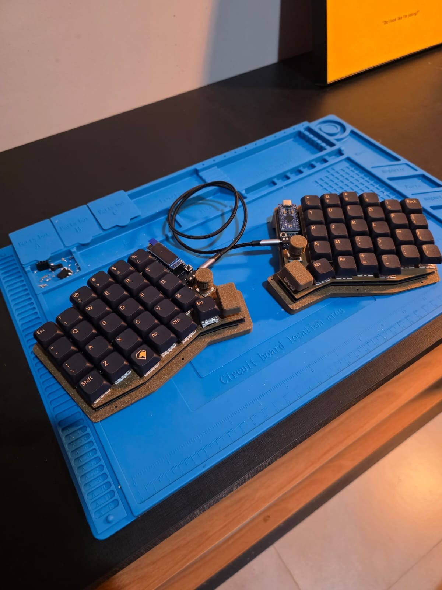
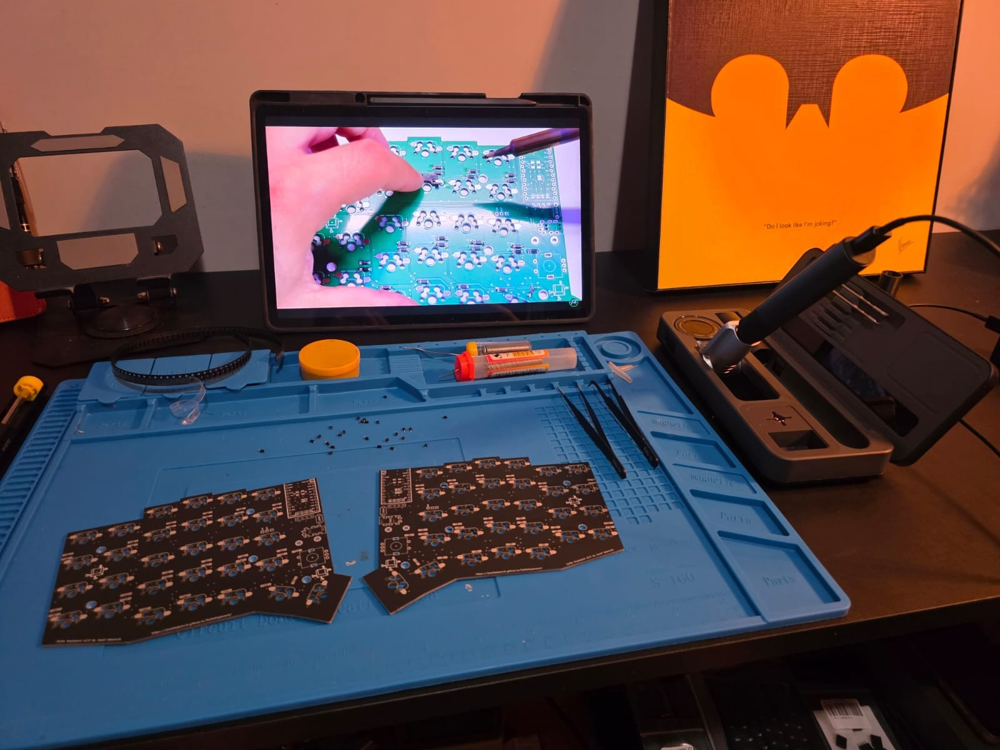
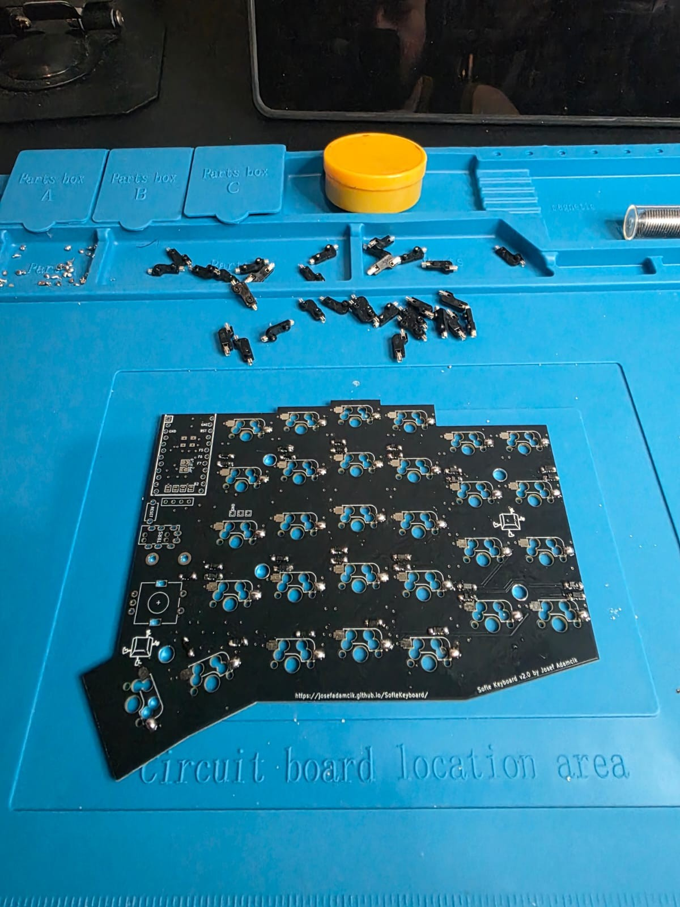
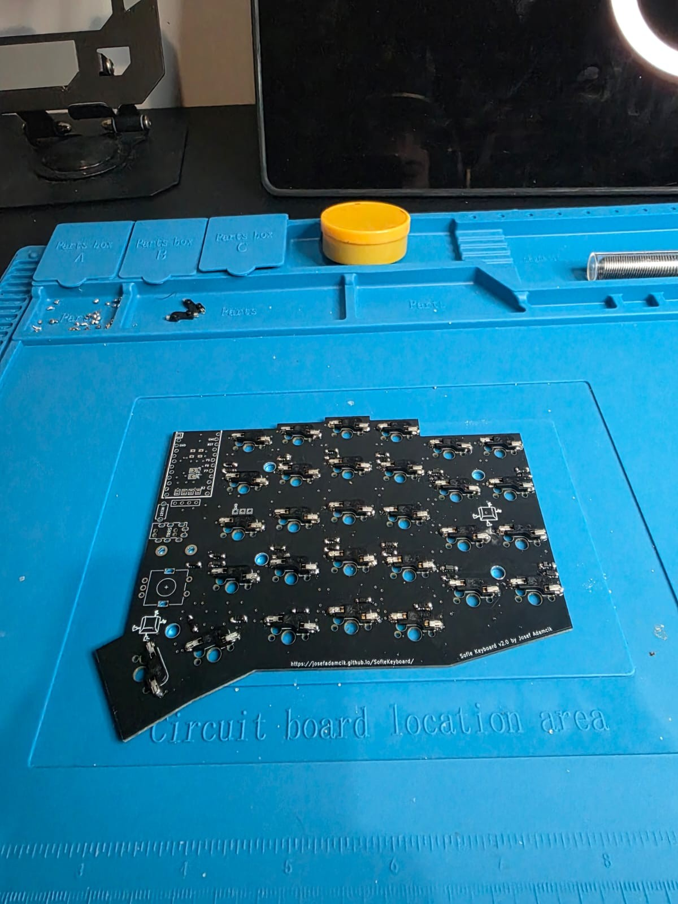
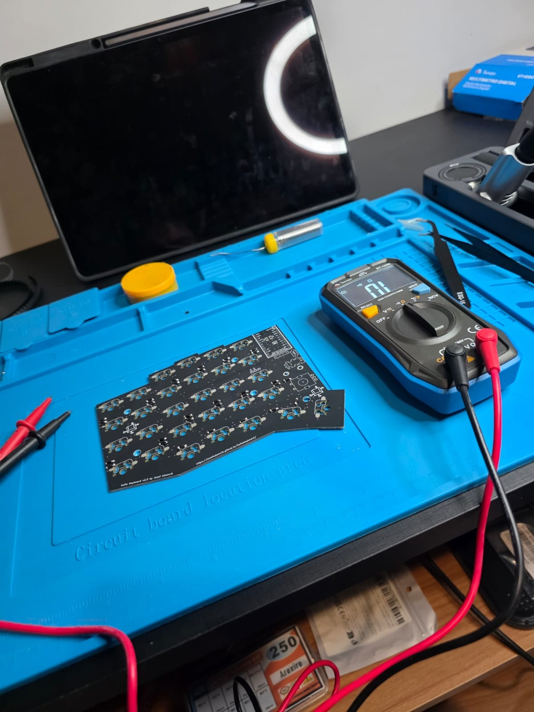
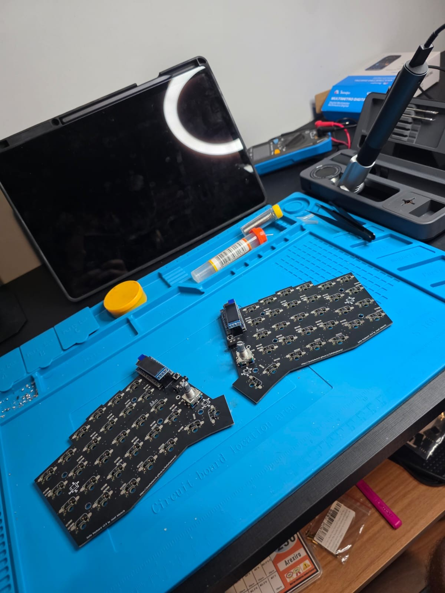
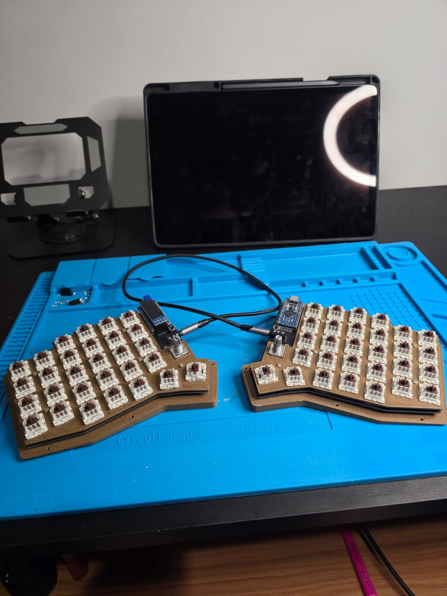

# Teclado Sofle v2 — repositório de montagem

Teclado split **Sofle v2.0.1 (sem RGB)**, switches MX hot-swap, Pro Micro, firmware QMK, case e placa de switches impressos em 3D. Este repositório reúne referências, arquivos e scripts para reproduzir a montagem do zero.

## Esta montagem

| Parte | Escolha |
| --- | --- |
| PCB | Sofle v2.0.1, JLCPCB (FR-4, preto) |
| Case | [Pehmis](https://github.com/Pelicram/Pehmis-Sofle-Case) impresso; placa de switches gerada do Gerber, também impressa |
| Controlador | 2× Pro Micro ATmega32U4 USB-C, OLED 128×32 e encoder EC11 (eixo Plum 15 mm) |
| Switches / keycaps | MX Brown (genérico) / XDAL, com polegares de 1.5u impressos |
| Knobs | Pehmis adaptado ao eixo Plum (Ø5,9 mm) ou versão steampunk |
| Firmware | QMK `sofle/rev1`, layout AFM (ABNT2): 3 camadas, encoders de volume e rolagem |

## Como começar

1. Copie `progress/PROGRESS.template.md` para `PROGRESS.md` na raiz (arquivo local, ignorado pelo git) e marque o avanço nele. Para recomeçar, copie de novo.
2. Siga a documentação em `docs/`, na ordem.

## Documentação

1. [Visão geral](docs/01-overview.md)
2. [Materiais (BOM)](docs/02-bom.md)
3. [Ferramentas](docs/03-tools.md)
4. [Pedido da PCB](docs/04-pcb-order.md)
5. [Impressão 3D](docs/05-3d-printing.md)
6. [Montagem](docs/06-assembly.md)
7. [Firmware](docs/07-firmware.md)
8. [Switches e keycaps](docs/08-switches-keycaps.md)
9. [Solução de problemas](docs/09-troubleshooting.md)
10. [Referências](docs/10-references.md)

## Galeria

| | | |
| --- | --- | --- |
|  |  |  |
| Bancada e PCBs | Diodos prontos | Sockets montados |
|  |  |  |
| Teste de continuidade | MCU, OLED e encoders | Switches no case |

## Estrutura

| Pasta/arquivo | Responsabilidade |
| --- | --- |
| [`docs/`](docs/) | Documentação de **referência** (como fazer), sem registro de progresso |
| [`progress/`](progress/) | Template do checklist de progresso (resetável) |
| [`hardware/pcb/`](hardware/pcb/) | Gerbers oficiais v2.0.1 |
| [`hardware/switch-plate/`](hardware/switch-plate/) | Placas de switches 3MF e tira de teste, geradas do Gerber |
| [`hardware/case-pehmis/`](hardware/case-pehmis/) | Peças do case Pehmis (3MF/STEP) |
| [`hardware/knob-plum/`](hardware/knob-plum/) | Knobs para o eixo Plum 15 mm: o do Pehmis com furo adaptado e a versão steampunk |
| [`hardware/keycaps/`](hardware/keycaps/) | Keycap 1.5u impresso (modelo de terceiros, não editar) |
| [`firmware/`](firmware/) | Keymaps (layout AFM e VIA) e `.hex` prontos com `SPLIT_USB_DETECT` |
| [`scripts/`](scripts/) | Geração da placa de switches, dos knobs e da imagem do Instagram (`requirements.txt` na raiz) |
| [`media/`](media/) | Fotos da montagem (`photos/`) e imagens do post do Instagram (`instagram/`: post, antes e depois) |
| [`archive/`](archive/assembly-guide-2026-10/) | Guia único original, desatualizado; use `docs/` |
| [`NOTICE.md`](NOTICE.md) | Licenças e créditos |

## Créditos

[SofleKeyboard](https://github.com/josefadamcik/SofleKeyboard) (Josef Adamčík, MIT), [Pehmis Sofle Case](https://github.com/Pelicram/Pehmis-Sofle-Case) (Pelicram, CC BY-NC-SA 4.0) e keycap 1.5u de Vostok Labs (CC BY-NC-ND 4.0). Detalhes em [NOTICE.md](NOTICE.md).
