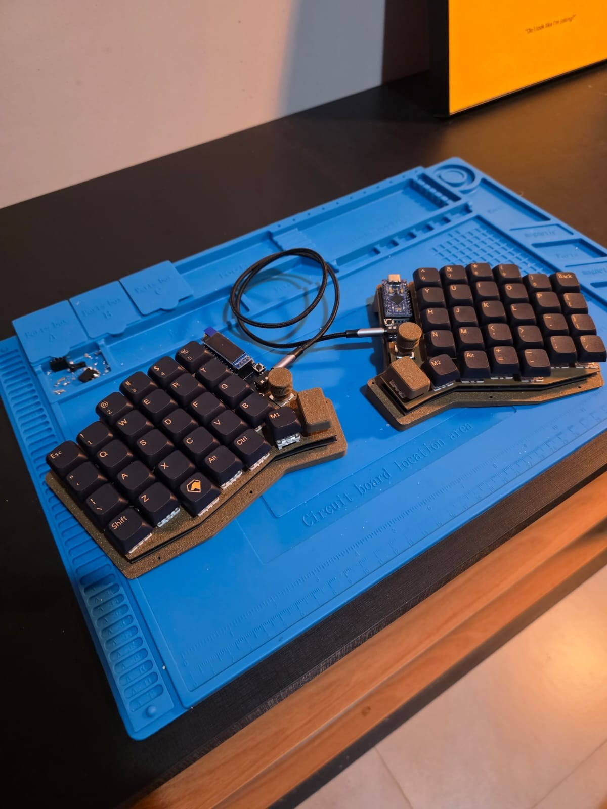

# Visão geral

> Parte da documentação de referência do projeto. Para marcar o que já foi feito, use `PROGRESS.md` (veja o [README](../README.md)).

O Sofle v2 é um teclado split (dividido) de 58 teclas, com colunas escalonadas (6×4 + 5 teclas de polegar por lado), projetado por Josef Adamčík a partir do Lily58, Corne e Helix ([projeto no GitHub](https://github.com/josefadamcik/SofleKeyboard)). Cada metade tem um microcontrolador próprio e as duas se ligam por um cabo TRRS; o computador se conecta por USB à metade esquerda.

- **Teclas:** 58 no total (29 por lado), sendo 5 de polegar por lado.
- **Extras:** um display OLED 128×32 e um encoder rotativo (knob) por lado, ambos opcionais.
- **Switches:** a v2 aceita apenas switches MX, sempre em sockets hot-swap Kailh (sem soldar os switches).
- **Firmware:** QMK (com suporte a VIA/Vial); variantes sem fio usam ZMK.

**Diferença principal da v2 para a v1:** na v2 o Pro Micro da metade direita é montado com a face dos componentes para cima, enquanto na esquerda fica com a face limpa para cima; a v1 também aceitava Choc. As versões RGB, Choc e Pico têm guias próprios (ver Variações).

## Esta montagem

| Parte | Escolha |
| --- | --- |
| PCB | Sofle v2.0.1 sem RGB, fabricada na JLCPCB ([pedido](04-pcb-order.md)) |
| MCU | 2× Pro Micro ATmega32U4 USB-C; esquerdo com a face limpa para cima, direito com os componentes para cima |
| Case e placa de switches | Case [Pehmis](05-3d-printing.md) e placa de switches gerada do Gerber, ambos impressos em 3D (sem FR4) |
| Knobs | Eixo Plum 15 mm; furo Ø5,9 mm, no modelo do Pehmis ou na versão steampunk |
| Switches e keycaps | MX Brown e XDAL; polegares de 1.5u impressos ([detalhes](08-switches-keycaps.md)) |
| Firmware | QMK `sofle/rev1`, layout AFM (ABNT2) com `SPLIT_USB_DETECT` ([firmware](07-firmware.md)) |

## Variações possíveis

As variações se dividem em versões de PCB (escolhidas antes de comprar) e escolhas de componentes (feitas sobre a mesma PCB).

**Versões de PCB da família Sofle** ([visão geral oficial](https://josefadamcik.github.io/SofleKeyboard/)):

| Versão | Switches | Iluminação | MCU | O que muda |
| --- | --- | --- | --- | --- |
| [Sofle v2](https://josefadamcik.github.io/SofleKeyboard/build_guide.html) | MX hot-swap | Nenhuma (só pads para fita LED) | Pro Micro | Base deste guia; MCU direito montado ao contrário do esquerdo |
| [Sofle RGB (v2.1)](https://josefadamcik.github.io/SofleKeyboard/build_guide_rgb.html) | MX hot-swap | Até 36 LEDs SK6812 mini por lado (por tecla + underglow + indicador) | Pro Micro | Stagger do mindinho mais suave; ambos os MCUs com componentes voltados à PCB; firmware `-km rgb_default` |
| [Sofle Choc](https://josefadamcik.github.io/SofleKeyboard/build_guide_choc.html) | Kailh Choc v1 hot-swap | RGB por tecla | Pro Micro | Perfil baixo, \~15 mm da mesa ao topo do keycap |
| [Sofle Pico](https://www.soflepico.com) | MX hot-swap | RGB por tecla | RP2040 Pico | Diodos THT ou SMD, OLED 128×64, gravação arrastando arquivo, furos para tenting |
| Aurora Sofle v2 ([splitkb](https://docs.splitkb.com)) | MX ou Choc | RGB | Pro Micro ou compatíveis (ex.: Liatris RP2040) | Redesenho comercial, firmware próprio (`splitkb/aurora/sofle_v2`) |
| Keyhive Sofle RGB | MX | RGB | Pro Micro | Fork incompatível com o firmware oficial; use guia e firmware da Keyhive |
| Sem fio (ex.: Sofle Hybrid, kits "wireless") | MX ou Choc | Opcional | nice!nano v2 (nRF52840) + bateria LiPo | Bluetooth, firmware ZMK; exige bateria e chave liga/desliga |

**Escolhas de componentes sobre a mesma PCB v2:**

- **Microcontrolador:** Pro Micro micro-USB (barato, porta frágil), Elite-C (USB-C, mesmo chip), ou clones RP2040 compatíveis com Pro Micro (USB-C, mais memória, gravação arrastando `.uf2`) usando o conversor do QMK (ex.: `-e CONVERT_TO=promicro_rp2040`). nice!nano funciona como substituto direto, mas exige ZMK e bateria.
- **Montagem do MCU:** soldado direto (mais baixo, permanente), sockets fêmea + pinos redondos (removível) ou spring pins (compactos e removíveis).
- **Telas:** OLED 128×32 em um, dois ou nenhum lado. Sem OLED em um lado, solde resistores pull-up de 4,7 kΩ (R1, R2) ou desative o OLED no firmware para evitar atraso na digitação.
- **Encoders:** EC11 em um, dois ou nenhum lado; no lugar do encoder pode ir um switch, dependendo da PCB.
- **Iluminação:** a v2 tem 3 pads (VCC, GND, dados) para ligar uma fita de LED RGB externa, configurada no firmware.
- **Case:** sanduíche (FR4, acrílico ou alumínio, espaçadores de 6–8 mm), tray case impresso em 3D ([exemplo no Printables](https://www.printables.com/model/268638-sofle-v2-case)), cases com tenting ou de madeira; espuma entre PCB e fundo reduz ruído.
- **Conexão entre metades:** TRRS (padrão) ou TRS; existe modificação com conector RJ12 ([Sofle V2 RJ12](https://gitlab.com/LayeredRx/Sofle_V2_Rj12/)).
- **Extras da comunidade:** trackball Pimoroni via I²C ([projeto](https://github.com/foureight84/sofle-keyboard-pimoroni)).

---

[Índice](../README.md#documentação) · [Lista de materiais (BOM)](02-bom.md) →
