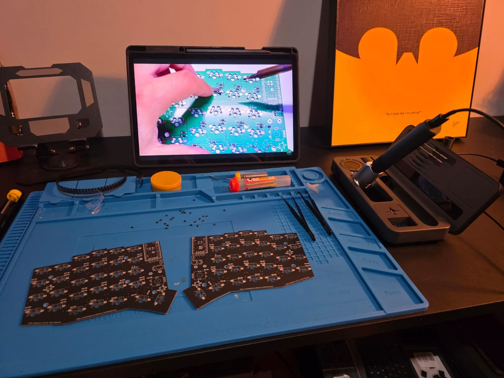

# Ferramentas

> Parte da documentação de referência do projeto. Para marcar o que já foi feito, use `PROGRESS.md` (veja o [README](../README.md)).

Um ferro de solda com controle de temperatura e uma pinça fina resolvem quase toda a montagem; o resto é apoio.

- **Essenciais:** ferro de solda (ideal com temperatura ajustável, ponta fina ou chanfrada), solda fina (0,5–0,8 mm, com fluxo), pinça de precisão, óculos de proteção, fita crepe, chave de fenda/Phillips pequena.
- **Recomendados:** extrator de fumaça, lupa ou lente de aumento, boa iluminação, fluxo extra, malha dessoldadora, multímetro (teste de continuidade), álcool isopropílico e cotonetes para limpar o fluxo.

Uma manta de silicone com divisórias para peças pequenas ajuda a não perder diodos e sockets (são minúsculos e rolam). Um tablet apoiado à frente serve para acompanhar um vídeo de montagem enquanto solda.

*Bancada usada neste projeto, com as duas PCBs ainda sem peças.*

---

← [Lista de materiais (BOM)](02-bom.md) · [Índice](../README.md#documentação) · [Pedido da PCB](04-pcb-order.md) →
