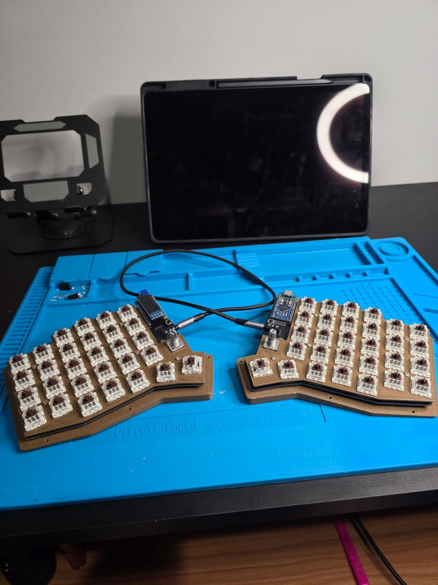
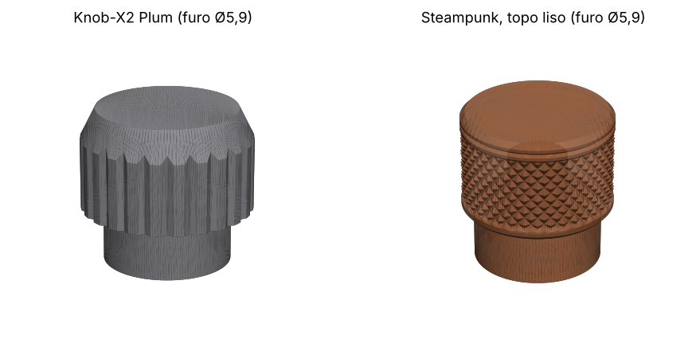

# Impressão 3D

> Parte da documentação de referência do projeto. Para marcar o que já foi feito, use `PROGRESS.md` (veja o [README](../README.md)).

## Case Pehmis

O modelo recomendado é o **[Pehmis Sofle Case](https://github.com/Pelicram/Pehmis-Sofle-Case)**, de Pelicram. É um case fechado, sem frestas, com apoios de pulso magnéticos, derivado do [SofleCase de kb-elmo](https://github.com/str-dst/SofleCase). Ele combina com as peças deste projeto:

- **Compatibilidade:** feito para a PCB Sofle **v2.0** (não serve para a v2.1 com RGB por tecla).
- **Pro Micro:** tem espaço para um Pro Micro comum montado em socket.
- **Knob:** o knob incluído foi feito para EC11 com eixo **Plum de 15 mm**.
- **Espaçadores:** usa os mesmos espaçadores M2 × 8 mm.

O Pehmis usa montagem tipo *tray*: a PCB com a placa de switches é aparafusada no fundo do case. **Ele não inclui a placa de switches**, que você imprime a partir do arquivo oficial (veja abaixo). A licença é CC BY-NC-SA 4.0: uso pessoal liberado, venda proibida.

## Arquivos e peças

Os arquivos ficam no repositório, em [`hardware/case-pehmis/`](../hardware/case-pehmis/), nas pastas `3mf` (já orientados para impressão) e `step` (para editar em CAD).

| Peça | Qtd. | Função |
| --- | --- | --- |
| `L-Top` / `R-Top` | 1 de cada | Carcaça superior; recebe os insertos roscados e os ímãs |
| `L-Bottom` / `R-Bottom` | 1 de cada | Fundo (tray), onde a PCB é aparafusada |
| `L-Wristrest` / `R-Wristrest` | 1 de cada | Apoios de pulso magnéticos (opcionais) |
| `Knob` | 2 | Knob para EC11 com eixo Plum de 15 mm |
| Placa de switches | 2 | Não incluída no Pehmis; arquivos prontos em `hardware/switch-plate/out/` |

As metades esquerda e direita **não são simétricas**, porque os furos de USB e TRRS mudam de posição. Imprima os dois arquivos; não espelhe um no fatiador.

## Como imprimir o case

- **Arquivos:** use os 3MF da pasta `hardware/case-pehmis/3mf`. Eles já vêm orientados e não precisam de suporte.
- **Material:** PETG ou PLA. O PETG aguenta melhor o calor, como num carro ao sol; o PLA é mais fácil e tem acabamento melhor.
- **Camadas:** 0,2 mm.
- **Paredes:** 3 a 4, para que os furos dos insertos e parafusos fiquem firmes.
- **Topo e fundo:** 4 a 5 camadas sólidas.
- **Preenchimento:** 15–25%.
- **Mesa:** a de PEI liso deixa as faces apoiadas mais bonitas. Use brim se as peças grandes tenderem a descolar nos cantos.
- **Cor:** imprima topo e fundo da mesma cor para um visual contínuo, ou em cores diferentes para destacar o fundo.

## Placa de switches

A placa de switches é a peça mais crítica: ela trava e alinha os switches, então as medidas precisam ser exatas.

**Arquivos prontos:** em [`hardware/switch-plate/out/`](../hardware/switch-plate/out/) há as placas com furos de 14,0, 14,1 e 14,2 mm e a tira de teste de tolerância. Para regenerá-las a partir do Gerber, rode `python scripts/generate_switch_plate.py` (veja [scripts/README.md](../scripts/README.md)). Os passos 1 a 3 abaixo só são necessários se você quiser refazer o modelo no CAD.

1. **Obtenha o desenho.** Baixe o [`v2-gerber-top.zip`](https://github.com/josefadamcik/SofleKeyboard/releases/download/v2.0.1/v2-gerber-top.zip) da versão v2.0.1. Abra-o no GerbView do KiCad (gratuito) e exporte o contorno, que inclui os furos dos switches, como DXF. Outra opção é usar um conversor online de Gerber para DXF.
2. **Extrude no CAD.** Importe o DXF no Fusion, Onshape, FreeCAD ou Tinkercad e extrude **1,5 mm**. Essa é a espessura em que as travas do switch MX encaixam: mais grossa, o switch não trava; mais fina, ele fica solto.
   1. **Opção mais rígida:** extrude 3 mm e faça, por baixo de cada furo, um rebaixo de \~15 × 15 mm, deixando só 1,5 mm de material na face de cima.
3. **Confira o modelo.** Devem aparecer 29 furos de 14 × 14 mm, os furos dos espaçadores e o recorte do encoder nas posições da placa original.
4. **Faça um teste de tolerância.** Antes da placa inteira, imprima uma tira de 1,5 mm com 3 furos de 14,0, 14,1 e 14,2 mm. Use a medida em que o switch encaixa com um clique e fica firme, e ajuste os furos no CAD se precisar.
5. **Imprima duas placas.** A placa original é reversível, então imprima uma normal e outra **espelhada no fatiador**, uma para cada metade.
6. **Configure a impressão:**
   1. **Material:** PETG ou PLA+, que flexionam menos que o PLA comum.
   2. **Posição:** deitada, com a face de cima voltada para a mesa, para que essa face fique lisa e os furos precisos.
   3. **Preenchimento:** 100%, sólido. Em 1,5 mm, isso deixa a placa sem vazios.
   4. **Altura de camada:** um valor que divida 1,5 mm exatamente, como 0,15 ou 0,25 mm, para a espessura sair certa.
   5. **Pé de elefante:** ative a compensação de primeira camada (0,1–0,15 mm). Sem ela, a primeira camada sai mais larga e estreita os furos justamente onde o switch trava.
7. **Faça o acabamento.** Remova o brim e passe um estilete nos cantos dos furos se algum switch entrar apertado.

A placa impressa flexiona um pouco mais que a de FR4. Com os 10 espaçadores no lugar, isso quase não se nota na digitação, mas segure a placa ao puxar um switch com o extrator, para não forçar o socket hot-swap da PCB.

Para as placas geradas por este repositório, os ajustes prontos para o Bambu Studio (PLA, camada de 0,12 mm, 4 paredes, 100% de preenchimento) estão em [`print-settings_bambu_PLA.txt`](../hardware/switch-plate/out/print-settings_bambu_PLA.txt); eles valem no lugar dos valores genéricos do passo 6.

*Placa de switches impressa em uso, com os switches encaixados.*

## Ordem de impressão sugerida

1. **Tira de teste de tolerância** (`tolerance-test_14.0-14.2mm.3mf`): 1, 2 ou 3 marcadores = furo de 14,0 / 14,1 / 14,2 mm. Escolha o que prende o switch com um clique e firme.
2. **Placa de switches** (2 peças, tamanho de furo escolhido: uma normal e outra **espelhada no fatiador**, como no passo 5 acima; o espelhamento vale só para a placa, não para o case).
3. **L-Top**: teste de encaixe com a placa de switches. Se algo não servir, corrija antes de gastar filamento no resto.
4. **R-Top**: só depois de validar o L-Top. As metades **não são simétricas**: não espelhe uma para fazer a outra.
5. **L-Bottom e R-Bottom**.
6. **Knob (Plum 15 mm)**: imprima antes a tira `hardware/knob-plum/fit-test_5.5-6.0mm.3mf` (poucos minutos), encaixe o eixo do EC11 em cada furo e escolha o que prende com um clique firme, sem trincar. No teste deste projeto, o furo de **Ø5,9 mm** foi o escolhido (o de Ø5,8 não entrou no eixo), então só ele é gerado: imprima 2× `Knob-X2_plum15_bore-5.9mm.3mf`, um de cada lado. Para gerar outros tamanhos, mude `BORE_SIZES` em `scripts/generate_knob.py`. O `Knob-X2` original do Pehmis tem furo liso de Ø6,1 mm e fica guardado, sem alteração.

   **Opção steampunk:** `hardware/knob-plum/knob-steampunk_bore-5.9mm.3mf` (imprima 2×). A cabeça é um cilindro de Ø15 (o Knob-X2 tem Ø17) com serrilhado diamante fino, friso em V, bordas chanfradas e topo liso ([prévia](../hardware/knob-plum/preview-steampunk.png)). A haste de Ø12,6, as alturas e todo o encaixe interno são idênticos aos do knob Plum de Ø5,9. Imprima com o topo na mesa, como vem no arquivo.

   

   Medidas do eixo Plum, lidas do desenho do anúncio do EC11 (Ø de fundo de dente e comprimento do serrilhado são estimativas do desenho): serrilhado com crista Ø6 (+0/−0,1 mm), fundo de dente ≈ Ø5,3 mm e fenda central de ≈ 1 mm, que deixa o eixo elástico. O L = 15 mm é contado a partir do corpo e inclui a rosca M7×0,75 de 5 mm, então o eixo sobra ≈ 10 mm acima da rosca (furo do knob: 10,8 mm de profundidade). Na tira, as marcas na borda indicam 1 a 6 furos, do menor (Ø5,5) ao maior (Ø6,0).
7. **Pés de 8 mm em TPU**.
8. **L-Wristrest e R-Wristrest**: por último e só se usar apoio de pulso (dependem dos ímãs 8×3 mm).
9. **Keycaps de polegar 1.5u** (opcional): [`hardware/keycaps/keycap-1.5u.3mf`](../hardware/keycaps/keycap-1.5u.3mf), modelo de terceiros (Vostok Labs, CC BY-NC-ND 4.0; veja [NOTICE](../NOTICE.md)). Não edite o arquivo. Teste o encaixe da haste num switch antes de imprimir o par.

## Configurações recomendadas por peça

> O README do Pehmis **não traz configurações de impressão**; informa só que os 3MF vêm orientados e dispensam suportes. Os valores abaixo são recomendações gerais, não do autor.

| Peça | Material | Camada | Paredes | Preenchimento | Observação |
| --- | --- | --- | --- | --- | --- |
| L/R-Top | PLA ou PETG | 0,2 mm | 3–4 | 15–20% | Peça visível. Velocidade menor nas paredes externas. |
| L/R-Bottom | PLA ou PETG | 0,2 mm | 3–4 | 20% | Os furos dos parafusos precisam de paredes firmes. Não reduza as paredes. |
| Knob Plum 15 mm | PLA ou PETG | 0,12–0,16 mm | 3 | 100% | O furo do eixo exige precisão. Compensação de primeira camada ligada. |
| Knob steampunk | PLA ou PETG (seda cobre/bronze combina) | 0,08–0,12 mm | 3 | 100% | Camada fina para definir o serrilhado. Topo na mesa: a textura da mesa fica no topo do knob (mesa lisa ou PEI texturizado, a gosto). |
| Pés de 8 mm | TPU 95A | 0,2 mm | 2–3 | 100% | 20–30 mm/s, retração mínima ou desligada. |
| L/R-Wristrest | PLA ou PETG | 0,2 mm | 3 | 15% | Os furos dos ímãs 8×3 mm podem precisar de ajuste de tolerância. |
| Placa de switches | PLA | 0,12 mm | 4 | 100% | Ajustes do arquivo [`print-settings_bambu_PLA.txt`](../hardware/switch-plate/out/print-settings_bambu_PLA.txt). Sem suportes e sem brim. |

## Dicas gerais

- **Suportes:** não são necessários. Mantenha a orientação original dos 3MF.
- **Material:** PETG aguenta melhor calor e impacto; PLA é mais fácil de acertar e basta para um teclado de mesa.
- **Insertos M2 (4 × 3,5 mm):** ferro a cerca de 200–230 °C no PLA, um pouco mais no PETG. Entre devagar e reto.
- **Furos apertados:** ajuste a expansão horizontal no fatiador, em vez de escalar a peça inteira.
- **Teste de encaixe:** imprima L-Top e L-Bottom e junte com a placa antes de fazer as metades da direita.

## Alternativas

- **[SofleCase de kb-elmo](https://github.com/str-dst/SofleCase):** o único case 100% impresso que inclui a placa de switches (topo, placa, fundo e knob). Foi feito para Elite-C e Puchi-C, e o autor avisa que o furo do USB não alinha direito com um Pro Micro comum.
- **[Sofle v2 case (Printables 268638)](https://www.printables.com/model/268638-sofle-v2-case):** só o fundo (tray), com os mesmos espaçadores de 8 mm. Exige a placa FR4 ou uma placa impressa.
- **[Sofle V2 (non-RGB) tenting case (Printables 615335)](https://printables.com/model/615335-sofle-v2-non-rgb-tenting-case):** só o fundo, com tenting de 21°. Pede espaçadores de 7 mm e o Pro Micro em socket.
- **Não servem para a v2:** os cases feitos para o Sofle RGB/v2.1, o Sofle Choc ou o Sofle Pico, cujos contornos são diferentes.

A montagem das peças impressas está em [Montagem](06-assembly.md).

---

← [Pedido da PCB](04-pcb-order.md) · [Índice](../README.md#documentação) · [Montagem](06-assembly.md) →
