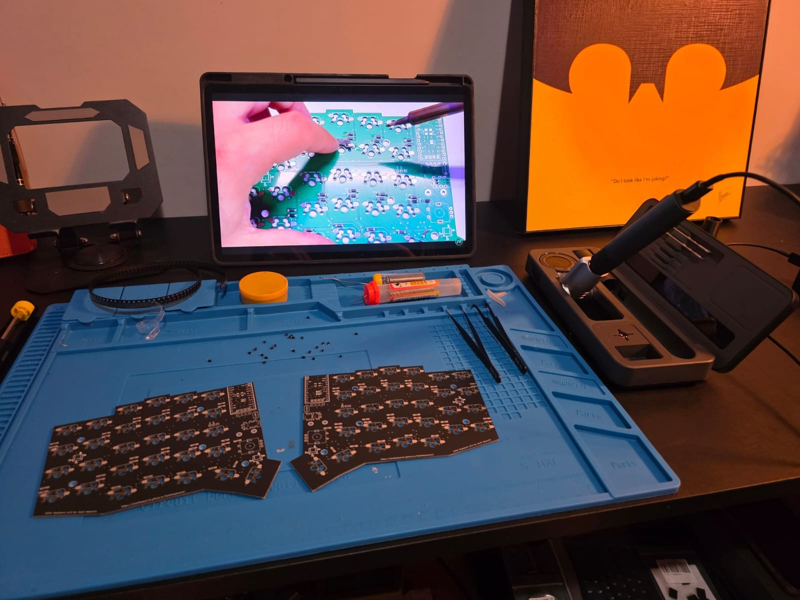
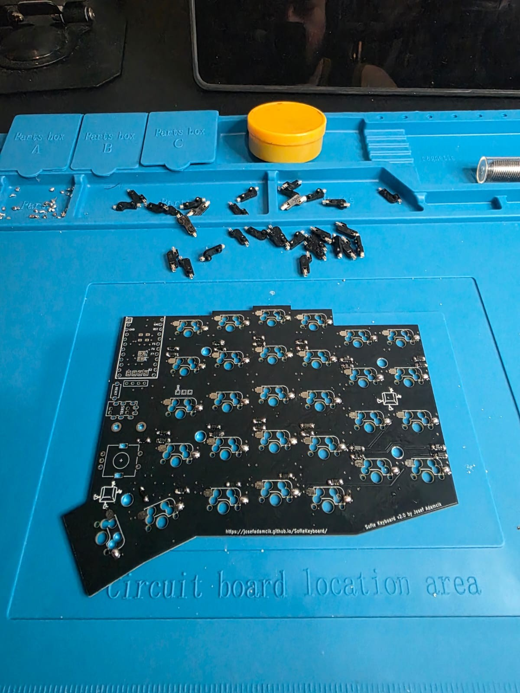
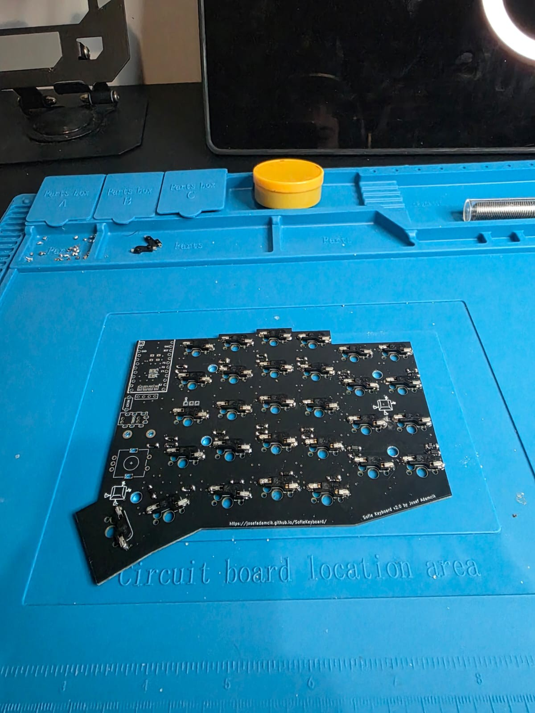
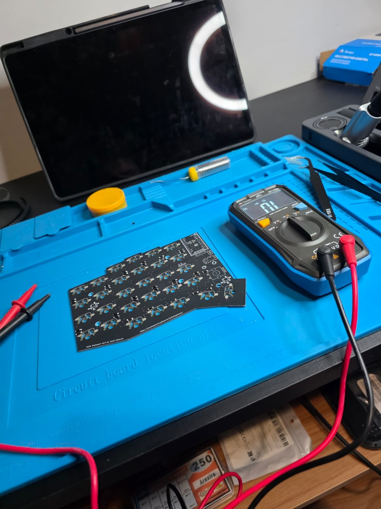
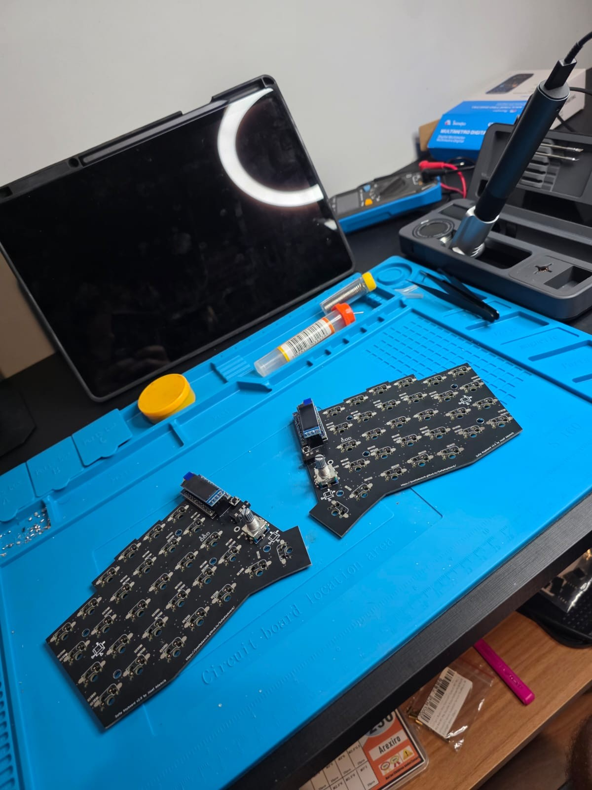
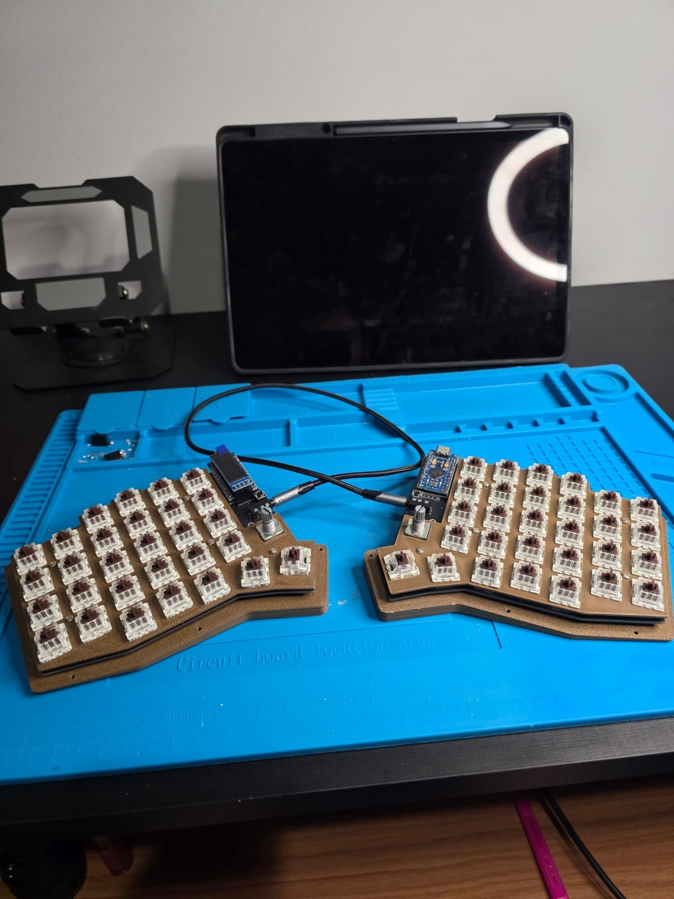
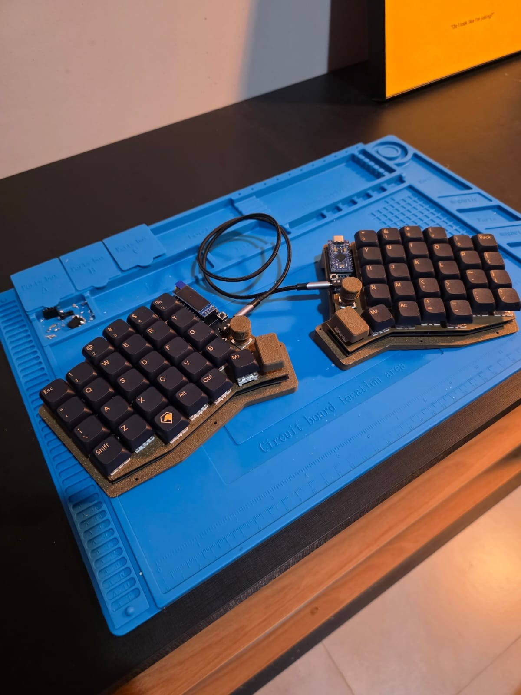

# Montagem

> Parte da documentação de referência do projeto. Para marcar o que já foi feito, use `PROGRESS.md` (veja o [README](../README.md)).

## Passo a passo da PCB

Monte as duas metades em paralelo: a PCB é a mesma, mas cada lado usa uma face diferente como topo. Pense duas vezes, solde uma vez — dessoldar é difícil e arrisca danificar as trilhas.

1. **Prepare e marque as placas.** Separe as duas PCBs e marque com fita qual face será o topo de cada metade (esquerda e direita ficam espelhadas). Confira se todas as peças chegaram.
2. **Solde os diodos (face de baixo).** Os 58 diodos vão na parte de baixo da PCB. A listra fina é o catodo (–) e deve apontar para o lado da seta/barra na serigrafia; todos ficam na mesma orientação.
   1. Técnica: estanhe um pad, posicione o diodo com a pinça, reaqueça o pad, depois solde o outro lado.

   

   *Diodos SMD soldados com um vídeo de montagem como guia. A mesma PCB serve às duas metades.*

3. **Solde os sockets hot-swap (face de baixo).** Mesmo lado dos diodos, seguindo o desenho da serigrafia. Pressione para que fiquem rentes à placa enquanto solda.

   

   *Diodos prontos; os sockets hot-swap ainda soltos, prontos para soldar.*

   

   *Sockets montados na face de baixo.*

4. **Solde o jack TRRS e o botão de reset.** O jack entra pela face de cima e é soldado por baixo (fixe com fita antes). Neste projeto, o **botão de reset é soldado por baixo da PCB**, para ficar acessível pelo furo do fundo do case (veja [Montagem no case impresso](#montagem-no-case-impresso)).
5. **Faça as pontes de jumper do OLED.** Una com solda os 4 pares de pads de jumper na face de cima. Faça isso antes de montar o MCU: se ele for soldado direto, não dá para fazer depois.
6. **Prepare e monte o Pro Micro.** Use sockets (recomendado) ou solde direto.
   1. Na v2, a metade **esquerda** recebe o Pro Micro com a face limpa para cima (componentes voltados para a PCB).
   2. Na metade **direita**, ele fica com a face dos componentes para cima.
   3. Sockets fêmea vão na PCB; os pinos macho no Pro Micro. Não solde o MCU antes de conferir a orientação.
7. **Instale o socket do OLED.** Considere a altura do Pro Micro com os sockets que você usou; confira o encaixe antes de soldar.
8. **Primeiro teste.** Antes de ligar o USB, use o multímetro em continuidade para procurar curto entre VCC e GND e entre trilhas vizinhas. Depois conecte MCU e OLED, grave o firmware ([Firmware](07-firmware.md)) e teste cada tecla fechando os contatos do socket com uma pinça ou pedaço de fio.

   

   *Teste de continuidade com o multímetro antes de ligar a placa.*

9. **Encoders (opcional).** Solde o EC11 em um, nos dois ou em nenhum lado. Limpe os resíduos de fluxo com álcool isopropílico.

   

   *Metades com Pro Micro, OLED e encoder montados, antes de encaixar os switches.*

10. **Switches e placas.** Encaixe os switches nos cantos da placa de topo primeiro, aparafuse os espaçadores, encaixe os switches com cuidado nos sockets (sem entortar os pinos) e complete o restante. Confira por baixo se todos os pinos entraram nos sockets.
11. **Feche o case.** Aparafuse a placa de fundo, coloque os keycaps e cole pelo menos 4 pés de borracha.

**Avisos:** nunca conecte ou desconecte o cabo TRRS com o teclado ligado ao USB (pode causar curto) — desconecte sempre o USB antes. Trate o conector USB do Pro Micro com cuidado: ele quebra com facilidade.

## Montagem no case impresso

1. **Solde o botão de reset por baixo da PCB.** Isso muda o passo 4 da montagem: com o botão por baixo, ele fica acessível pelo furo no fundo do case, sem desmontar o teclado.
2. **Monte o teclado normalmente:** PCB, espaçadores M2 × 8 mm, placa de switches impressa e switches. Não instale a placa de fundo FR4.
3. **Instale os insertos roscados** nos furos de `L-Top` e `R-Top`. Aqueça o inserto com o ferro de solda e empurre na vertical até ficar rente, a \~200–220 °C para PLA ou \~230–240 °C para PETG.
4. **Aparafuse cada metade no fundo:** a PCB com a placa vai em `L-Bottom` ou `R-Bottom`, com os parafusos M2 × 4 mm.
5. **Feche o case:** encaixe cada fundo no topo correspondente e aparafuse com os M2 × 8 mm.
6. **Coloque os knobs** nos encoders (veja os [knobs Plum](05-3d-printing.md#ordem-de-impressão-sugerida)).
7. **Cole os ímãs** nos furos de `L-Top`, `R-Top`, `L-Wristrest` e `R-Wristrest`. Antes de colar, marque a polaridade com caneta, para que cada par se atraia em vez de se repelir.
8. **Coloque os pés** de 8 mm nos encaixes do fundo.

*Switches encaixados na placa impressa, dentro do case, antes dos keycaps.*

*Resultado: keycaps XDAL, teclas de polegar de 1.5u impressas em 3D e knobs impressos.*

> A montagem acima assume o **botão de reset soldado por baixo** da PCB (passo 4 do passo a passo da PCB), acessível pelo furo do fundo do case Pehmis. Não instale o fundo de FR4/acrílico.

---

← [Impressão 3D](05-3d-printing.md) · [Índice](../README.md#documentação) · [Firmware](07-firmware.md) →
