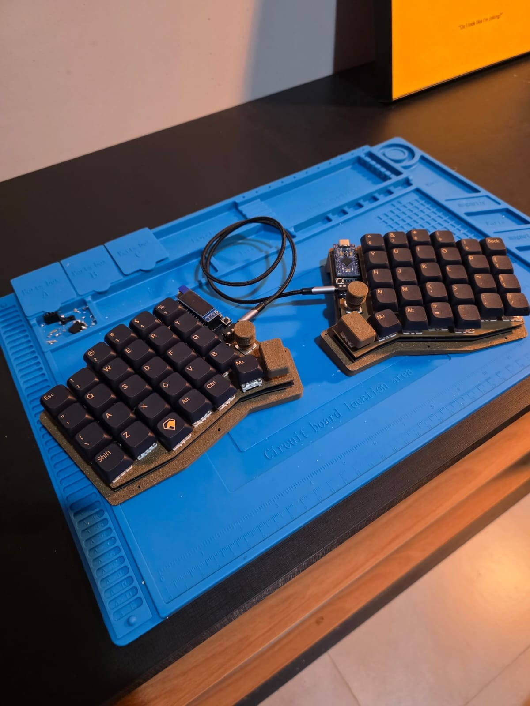

# Switches e keycaps

> Parte da documentação de referência do projeto. Para marcar o que já foi feito, use `PROGRESS.md` (veja o [README](../README.md)).

O Sofle v2 usa sockets hot-swap MX, então qualquer switch com haste MX serve e dá para trocar depois sem soldar. Por isso, a escolha dos switches é sobre sensação e som, não sobre compatibilidade. Já nos keycaps, o formato importa mais por causa do layout em colunas.

## Neste projeto

- **Switches:** MX táteis Brown de marca genérica (100 comprados; lotes genéricos variam, então teste alguns antes de montar).
- **Keycaps:** kit XDAL de 96 teclas (perfil uniforme baixo, da família XDA), com legenda alaranjada sobre fundo azul-marinho.
- **Polegares:** as duas teclas de 1.5u foram impressas em 3D com [`hardware/keycaps/keycap-1.5u.3mf`](../hardware/keycaps/keycap-1.5u.3mf), na cor do case.

## Tipos de switch

| Tipo | Sensação | Som | Indicado para |
| --- | --- | --- | --- |
| **Linear** | Curso liso, sem degrau, do topo ao fundo | Baixo a médio (vem do batente) | Jogos, digitação rápida, quem gosta de toque leve |
| **Tátil** | Um "degrau" perceptível perto do ponto de acionamento | Médio | Digitação longa: o degrau avisa que a tecla acionou |
| **Clicky** | Degrau tátil e um clique audível | Alto | Uso individual; incomoda em escritório ou chamadas |
| **Silencioso** (linear ou tátil) | Como os anteriores, com amortecedores na haste | Bem baixo | Escritório, ambiente compartilhado, gravação |

## O que olhar na especificação

- **Força de acionamento (gf):** de 35–45 gf é leve, 50–55 gf é médio e 60 gf ou mais é pesado. Num split como o Sofle, onde cada dedo tem sua coluna, switches leves a médios cansam menos os mindinhos.
- **Pré-curso e curso total:** o pré-curso padrão é de \~2 mm até acionar, com 4 mm de curso total. Switches "speed" acionam antes, por volta de 1,2 mm.
- **3 ou 5 pinos:** os 5 pinos têm dois pinos plásticos extras de estabilidade. Ambos encaixam no socket Kailh; se a PCB não tiver os furos laterais, basta cortar os pinos plásticos.
- **Materiais:** carcaça de policarbonato (PC) soa mais aguda e brilhante; nylon soa mais grave e abafado; haste de POM ou UPE é mais lisa. Os nomes "Milky", "Ink" e "Creamy" costumam indicar a mistura de materiais.
- **Pré-lubrificado de fábrica:** hoje é comum mesmo em modelos baratos e deixa o curso mais liso e menos arranhado.

## Modelos populares

| Modelo | Tipo | Força aprox. | Faixa | Observação |
| --- | --- | --- | --- | --- |
| Outemu Red / Outemu Sky | Linear | \~45 gf | Econômico | Bom para o primeiro teclado ou para aprender a lubrificar |
| Gateron Milky Yellow Pro (V2) | Linear | 50 gf | Econômico | A recomendação de custo-benefício mais citada pela comunidade |
| Akko V3 Cream Yellow / Creamy Black Pro | Linear | \~50 gf | Econômico | Som "creamy", vem lubrificado |
| Epomaker Creamy Jade | Linear | \~45 gf | Econômico | Pacotes de 90–110 unidades, som grave |
| Cherry MX Red / MX2A Red | Linear | 45 gf | Médio | O clássico de referência |
| Gateron Oil King (V2) | Linear | 55 gf | Premium | Muito liso e de som grave; entre os lineares mais bem avaliados |
| Cherry MX Brown | Tátil | 55 gf | Médio | Degrau suave; a opção "segura" para quem nunca usou tátil |
| Glorious Panda / HMX Jammy | Tátil | \~67 gf / médio | Premium | Degrau forte e nítido, para quem quer sentir bem cada tecla |
| Boba U4T | Tátil | 62 ou 68 gf | Premium | Degrau forte e som abafado |
| Akko V3 Penguin Silent | Tátil silencioso | \~50 gf | Econômico | Silencioso com degrau leve |
| Cherry MX Silent Red / TTC Silent Red | Linear silencioso | \~45 gf | Médio | Para escritório e gravação |
| Cherry MX Blue / Kailh Box White | Clicky | \~50–60 gf | Econômico a médio | O Box White tem clique mais limpo e menos chiado |

**Recomendações para o Sofle:**

- **Primeira montagem:** um linear econômico e pré-lubrificado, como o Gateron Milky Yellow Pro, ou um tátil leve, se você digita mais do que joga.
- **Na dúvida:** compre um *switch tester* (kit com 9–30 switches diferentes) antes de pedir 60 unidades do mesmo modelo.
- **Quantidade:** 58 switches mais reserva. A maioria vem em pacotes de 35, 70, 90 ou 110 unidades, então dois pacotes de 35 ou um de 70 resolvem.
- **Pesos diferentes:** como é hot-swap, dá para usar molas mais leves nas colunas do mindinho e mais firmes no resto.

## Perfis de keycap

O perfil é o formato e a altura da tecla. Nos perfis **esculpidos**, cada fileira (R1 a R4) tem altura e ângulo diferentes. Nos perfis **uniformes**, todas as teclas têm o mesmo formato e podem ir em qualquer posição.

| Perfil | Tipo | Altura aprox. | Formato do topo | No Sofle |
| --- | --- | --- | --- | --- |
| Cherry | Esculpido | \~9,4 mm | Cilíndrico | Funciona se você respeitar as fileiras; o mais comum em kits de qualidade |
| OEM | Esculpido | \~11,9 mm | Cilíndrico | O padrão de teclados prontos; mesmo cuidado com as fileiras |
| SA | Esculpido | \~16,5 mm | Esférico | Alto e retrô; pede apoio de pulso |
| MT3 | Esculpido | \~16,5 mm | Esférico fundo | Visual vintage, também alto |
| KAT | Esculpido | \~13,5 mm | Esférico | Entre Cherry e SA |
| ASA | Esculpido | entre OEM e SA | Esférico | Variante da Akko |
| **XDA** | **Uniforme** | **\~9,1 mm** | Esférico, topo largo | **Ótimo:** qualquer tecla em qualquer posição |
| **DSA** | **Uniforme** | **\~7,6 mm** | Esférico | **Ótimo:** baixo e fácil de completar |
| KAM | Uniforme | \~11 mm | Esférico | Versão uniforme do KAT |
| SLK | Uniforme | \~18% mais baixo que DSA | Côncavo | Feito para splits; vendido em kits "Ergo" |

**Por que o perfil uniforme é mais fácil no Sofle:**

- As teclas de polegar e a coluna extra de cada lado não existem num teclado comum. Com perfil uniforme, qualquer 1u serve em qualquer lugar.
- Com perfil esculpido, monte por fileira: R1 na fileira de números, R2 na de cima, R3 na do meio (onde ficam F e J), R4 na de baixo e nos polegares. Kits grandes têm 1u suficientes de cada fileira.

## Materiais e legendas

| Material | Toque | Durabilidade | Som |
| --- | --- | --- | --- |
| **ABS** | Liso | Fica brilhante com o uso | Mais agudo |
| **PBT** | Texturizado, seco | Não brilha, resiste bem | Mais grave |
| **POM** | Muito liso | Alta | Grave; raro e caro |

- **Doubleshot:** a legenda é uma segunda camada de plástico injetada e nunca apaga. Comum em ABS.
- **Dye-sub:** a tinta penetra no PBT e também não apaga, mas só funciona com legenda escura em tecla clara.
- **Laser ou impressão:** mais barato, pode desgastar com o tempo.
- **Sem legenda (blank):** comum em splits, porque o layout costuma ser personalizado com camadas.

## O que comprar para o Sofle

- **Composição:** 56 teclas 1u e 2 teclas 1.5u para os polegares externos, ou 58 de 1u. Garanta duas teclas com marcação de posição (homing) para F e J.
- **Haste:** cruz MX ("Cherry MX compatível"). Keycaps para Choc ou de perfil baixo Choc não encaixam.
- **Kits indicados:** kits "Ergo", "40%" ou "Ortho", que trazem muitas 1u e algumas 1.5u; kits XDA ou DSA em PBT (blank ou dye-sub) do AliExpress, com mais de 100 teclas; ou um kit Cherry completo (104 a 140 teclas), usando as 1u de cada fileira.
- **Impressão 3D:** como você já imprime, existem modelos com haste MX prontos para imprimir, como o FormKey no MakerWorld. Imprima com o topo para cima e teste o encaixe da haste antes de imprimir o conjunto.

---

← [Firmware](07-firmware.md) · [Índice](../README.md#documentação) · [Solução de problemas](09-troubleshooting.md) →
